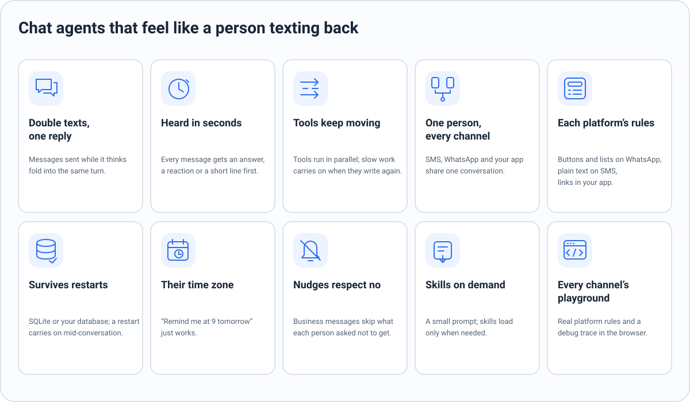
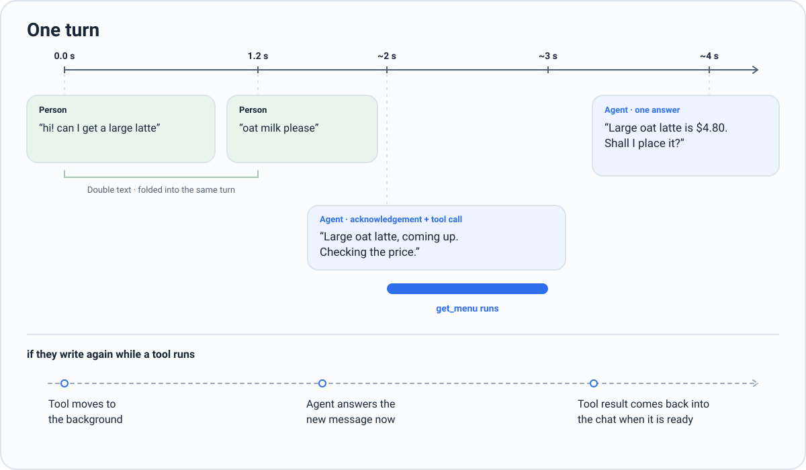
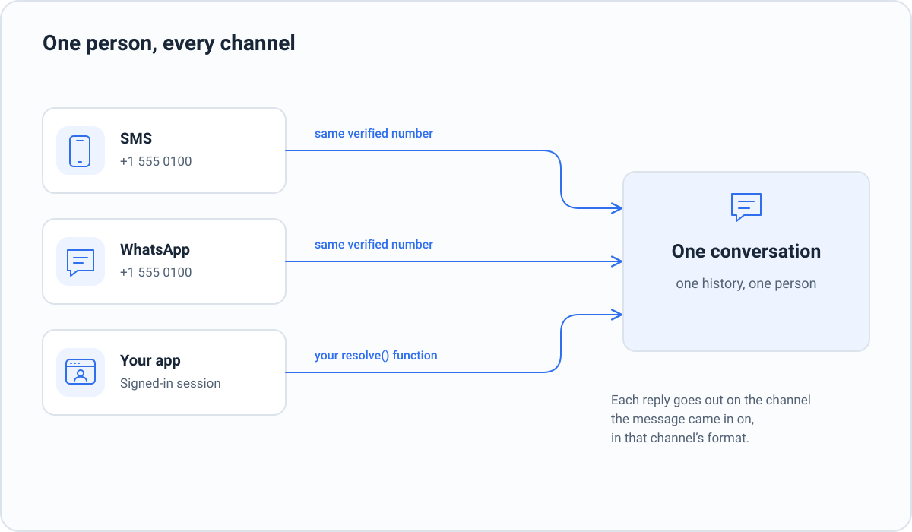

# Parley

**Chat agents that feel like a person texting back**, on WhatsApp, SMS, iMessage, Telegram and your own app.

[](LICENSE)  


## Why

Agent SDKs are built for agents that work alone on long tasks. Put one in a chat and it shows:

- Someone sends "hi", then "I need to move my booking", and gets two replies, the first already wrong.
- A tool is slow and the chat goes silent for forty seconds.
- They text on SMS, then WhatsApp, and the agent has never met them.
- "Remind me at 9 tomorrow" never arrives, because the agent has no clock.

Parley makes the chat behaviour the default. You write the agent's prompt, skills and tools; Parley handles the conversation.



## Quick start

Node 22.18 or later. Parley is not on npm yet: clone it and start from the example.

```bash
git clone https://github.com/flow-engineer/messaging-agents-framework.git
cd messaging-agents-framework && npm install
cd examples/cafe
echo "OPENROUTER_API_KEY=sk-or-..." > .env
npm start
```

Open the link it prints and text Pip, a café ordering assistant. Pick a platform at the top (SMS, WhatsApp, iMessage, Telegram, web), and turn on **Debug** to see every tool call and how fast each message was answered.

## How a turn works



| When | Parley does |
|---|---|
| They send several messages in a row | Folds them into one turn; a model step in flight restarts with all of them |
| They write | Shows typing at once; the first thing they get is an answer, or an acknowledgement sent with the tool calls |
| The agent calls tools | Runs them in parallel and waits for them, so they get one answer, not an "on it" and a result later |
| They write again while a tool runs | The agent reads it at once; the tool carries on in the background and its result comes back into the chat |
| A tool passes its limit (`deadlineMs`, 60 s by default) | It moves to the background the same way |
| The model writes text without sending it | It is reminded once to send it; text it already sent is not repeated |

## Build an agent

An agent is a prompt, a few skills and plain functions, so a coding agent can build and change one end to end. The snippets import `parley` and `@parley/simulators`; inside this repository, import from `src/` and `simulators/src/` by path, as [`examples/cafe`](examples/cafe) does.

```
my-agent/
  agent/AGENTS.md                the agent's prompt
  agent/skills/<name>/SKILL.md   rules for one kind of request, loaded only when needed
  src/tools.ts                   tools: plain functions with a zod input
  src/agent.ts                   buildAgent(): the one place the agent is built
  src/main.ts                    runs it in the playground
  tests/scenarios/*.yaml         tests: one situation each
  tests/tools/*.yaml             how each tool behaves in tests
```

**Tools** are functions with a zod input. Return anything; it is shown to the model as JSON.

```ts
import { tool, z } from "parley";

export const tools = [
  tool({
    name: "get_menu",
    description: "The full menu: items, sizes with prices, milk options and allergens.",
    input: z.object({}),
    run: async () => ({ menu: await pos.menu() }),
  }),
];
```

**The agent** is built in one function, which the playground and the tests both call:

```ts
import { fileURLToPath } from "node:url";
import { createAgent, openAICompatible, type EventSink, type Model, type Tool } from "parley";
import { tools as myTools } from "./tools.ts";

export const tools = myTools;

export function buildAgent(options: { model?: Model; events?: EventSink[]; tools?: Tool[] } = {}) {
  return createAgent({
    dir: fileURLToPath(new URL("../agent", import.meta.url)),
    model: options.model ?? openAICompatible({ model: "anthropic/claude-haiku-5.5" }),
    tools: options.tools ?? myTools,
    events: options.events ?? [],
  });
}
```

**The playground** serves it in every simulator:

```ts
import { simulators } from "@parley/simulators";
import { buildAgent } from "./agent.ts";

const play = simulators({ title: "My agent" });
await play.listen(buildAgent({ events: [play.events] }), 8788);
```

The playground plays only the test people you declare (`testPeople: [{ name, phone }]`) on the agent's own channels. A test person is a real person to the agent: the same identity, `resolve` and history as if they wrote from their phone, one conversation on every channel, and "Clear history" to start again. Replies go back where the person last wrote from, the playground or the real channel. On a deployed agent, mount `play.handler(agent, { token })`: it refuses requests without the token (at least 32 characters), swaps `?token=` for a cookie on the playground's path, and limits wrong tries.

`AGENTS.md` says what the agent is for and what it may and may not do. Leave messaging out of it: Parley adds how to talk on each channel (its send tool, reactions, formatting, acknowledging first). A skill's `SKILL.md` starts with a `name` and `description`; the agent sees every description and loads a skill when it needs it (`inlineSkills: true` puts them all in the prompt instead).

## Channels and people



A channel is a definition: Parley knows the platform's rules, your provider only says how to send.

```ts
const wa = whatsapp({
  sendMessage: (to, m) => api.send(to, m),            // m: { text, replyTo?, buttons?, list? }
  react: (to, id, emoji) => api.react(to, id, emoji),
});
const text = sms({ sendMessage: (to, m) => twilio.send(to, m.text) });
const app = customUI("app", {
  params: { app_link: z.string().describe("A link a tool result gave you") },
  instructions: "Only fill app_link with a URL from a tool result; never make one up.",
  sendMessage: (to, m) => myApp.push(to, m),          // m.text, m.app_link
});

const agent = createAgent({
  dir, model, tools,
  channels: [wa, text, app],
  database: sqlite("data/agent.db"),
  resolve: ({ channel, address }) => members.idFor(channel, address),
  timeZone: "America/New_York",
});
await agent.resume();
await agent.message({ channel: "whatsapp", from: "+15550100100", message: "hi" });
```

- **Each platform's rules are built in:** WhatsApp buttons, lists, replies, reactions and its 24-hour window; SMS as plain text in segments; your app's own fields. Features your provider lacks are never offered to the model.
- **One person, one conversation.** The same number on SMS and WhatsApp is one person. Anything else (your app, your website) is joined only by your `resolve`. Parley never guesses.
- **The agent gets one send tool per channel** (`send_sms`, `send_whatsapp`, `send_app`) and answers each message where it came in. `instructions` guide the agent on that channel only.

## Reminders and nudges

Built in, so you don't write them as tools:

- **Scheduled messages.** People ask ("remind me at 9 tomorrow"); the agent schedules, lists and cancels them in the person's own time zone. When one is due, the agent writes it in the context of the chat.
- **No-contact rules.** "No promotions", "nothing before 9am": the agent keeps them per person, and they apply on every channel.
- **Nudges, messages your business starts:**

```ts
await agent.nudge({ to: { channel: "whatsapp", address: "+15550100100" }, prompt: "Their order is ready for pickup." });
```

`text` sends it as written, `prompt` lets the agent write it (or decide not to), `template` sends a WhatsApp template. `at` sends it later, and `idempotencyKey` makes a retry safe. A nudge a no-contact rule covers is dropped, and outside WhatsApp's 24-hour window only templates go out.

## State, restarts and hosting

- Everything is stored as it happens: history, messages not yet handled, background tools, schedules. SQLite is built in (`sqlite("file.db")`; in memory by default). Postgres: `postgres(pool)` over your own node-postgres pool. Any other engine: implement the three-method `Database` interface, or pass a whole `store` of your own.
- After a restart, `await agent.resume()` carries on: cut-off turns run again, and background tools that were running are reported as interrupted, never silently rerun.
- `agent.status()` says whether anything is running and for how long it has been idle, so your platform can stop idle agents and start them on the next message.
- Every message, turn, model call (tokens and cost), tool and schedule is an event. Send events wherever you like; `jsonlSink(path)` writes them to a file.

## Testing

Write tests as situations, not scripts. A model plays the person, another plays your tools from the scenario's world, and a judge grades the run.

```yaml
id: latte-correction
channels: [whatsapp]
person:
  persona: Sam, in a hurry; types in short bursts.
  goal: Get a large oat latte for pickup, under the name Sam.
opening:
  - say: "can i get a large latte"
  - say: "oat milk actually"
    after_ms: 1200
world: The point of sale is slow this morning, but orders go through.
expect:
  outcome:
    - Exactly one order is placed, for one large latte with oat milk.
  judge:
    - The agent asks Sam to confirm before placing the order.
```

`tests/tools/*.yaml` describe how each tool behaves (normal, slow, each error). Run the suite from the agent's folder:

```bash
node --env-file=.env ../../testing/src/cli.ts --cloud <test cloud URL> --runs 3 --only latte-correction
```

Your agent stays on your machine with its own model and key; the test cloud plays the person and the tools and judges each run. The cloud is a hosted service, not part of this repository. The CLI prints pass or fail per run, with the judge's reasons, the cost, and a link to watch each conversation.

## Models

Any OpenAI-compatible API. `openAICompatible` defaults to OpenRouter and reads `OPENROUTER_API_KEY`; pass `baseURL` and `apiKey` for OpenAI, Gemini, Anthropic or a local server.

For agents with tools we recommend **Claude Haiku 5.5** (`anthropic/claude-haiku-5.5`) or **GPT-6.1 Sol** (`openai/gpt-6.1-sol`, about 3x the cost). In our tests, GPT Luna repeated tool calls and answered twice.

## `createAgent` options

| Option | What it does |
|---|---|
| `dir` | The folder with `AGENTS.md` and `skills/` |
| `model` | Any `Model`; `openAICompatible({ model })` for most |
| `tools` | Your tools |
| `channels` | `whatsapp()`, `sms()`, `customUI()` definitions |
| `resolve` | Your key for a person from a channel identity, to join channels |
| `database` | Where state lives (`sqlite()` in memory by default) |
| `testPeople` | Who the playground may play: `[{ name, phone }]` |
| `files` | `AGENTS.md` and skills as text, instead of `dir`, where there is no folder to read |
| `context` | Text added to every turn: who this person is, the time |
| `intercept` | Answer some messages without the model (STOP, HELP) |
| `timeZone` | The business's time zone, for schedules when a person's is unknown |
| `deadlineMs` | The longest a reply waits for a tool (60,000); a tool can set its own |
| `partialAfterMs` | How long a finished tool's result waits for the others (5,000) |
| `debounceMs` | Quiet time after a message before the reply starts (300) |
| `inlineSkills` | Put every skill in the prompt instead of loading on demand |
| `shareUpdates` | Live status lines on web and app UIs (on); a string replaces the guidance |
| `events` | Where events go |

## With a coding agent

Point Claude Code, Codex or any coding agent at [`coding-agents/`](coding-agents): `skill.md` builds an agent, `tools-skill.md` writes tools and their test files, `test-skill.md` writes scenarios. The café in [`examples/cafe`](examples/cafe) is a complete agent with tests to copy from.

## Repository

| Folder | What it is |
|---|---|
| [`src/`](src) | The runtime |
| [`simulators/`](simulators) | The playground: SMS, WhatsApp, iMessage, Telegram and web, with each platform's rules |
| [`testing/`](testing) | Test file formats and the CLI that runs them in the test cloud |
| [`examples/cafe/`](examples/cafe) | Pip, an ordering assistant, with tests |
| [`coding-agents/`](coding-agents) | Skills for coding agents |

`npm test` runs the runtime's tests and `cd simulators && npm test` the simulators'. Unit tests never call a real model. Read [AGENTS.md](AGENTS.md) before contributing.

## FAQ

**Who is it for?** Anyone putting an agent in front of people in a chat: a booking assistant, a shop's order bot, a support agent. If your agent mostly talks to a person and calls tools, it is for you. If it works alone for an hour on a codebase, use a general agent SDK.

**How is it different from general agent frameworks?** Those give you an agent loop, and a chat is one more thing you build on top. Parley is opinionated about chat: one actor per conversation, double texts folded into one turn, tools that never stall the chat, acknowledgements, channel rules, one person across channels, and schedules built in.

**Which channels are real?** WhatsApp, SMS and your own UI (`customUI`) have production definitions today; you plug in any provider by writing `sendMessage`. iMessage and Telegram are in the playground for now.

**Does it host my agent?** No. It runs in your Node process, on your machine or servers. You pay your model and messaging providers directly.

**Is the data mine?** Yes. State lives in your database, and events go wherever you send them.

**What does a double text do mid-reply?** While the agent is thinking, its step restarts with everything they said, so they get one reply. While a tool runs, the agent reads the new message at once and the tool carries on in the background.

**Is it on npm?** Not yet. Clone the repository and build next to the examples.

## License

[MIT](LICENSE)
