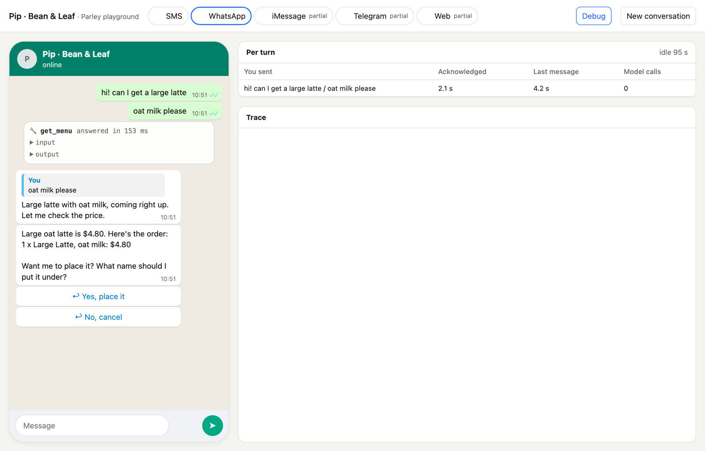

# Parley

A framework for chat agents that feel like a person texting back, on WhatsApp, SMS, iMessage,
Telegram and web or app chat.

You write the agent's prompt, skills and tools. Parley handles the conversation:

- **Double texts** fold into the reply being written, so a quick correction is answered once.
- **Acknowledgement first:** after someone writes, the first thing they get is an answer or a short
  acknowledgement, never silence while tools run.
- **Tools run in parallel** and the reply waits for them. A tool moves to the background only when
  the person writes again or it passes its own limit; its result comes back into the chat.
- **One person across channels:** the same phone number on SMS and WhatsApp is one conversation,
  and your own resolver can join a web or app visitor to them.
- **Channels with their real rules:** `whatsapp()`, `sms()` and `customUI()` definitions know each
  platform's limits (length, buttons, lists, reactions, the WhatsApp 24-hour window).
- **Durable:** history, pending events and background tools live in SQLite or Postgres, so a
  restart carries on where it stopped.
- **Scheduled messages and nudges:** people ask for reminders; the business can start messages,
  within each person's no-contact rules.

## The playground

Talk to your agent in the browser, on simulators that follow each platform's real rules: SMS,
WhatsApp, iMessage, Telegram and web. Debug shows every tool call where it happened and how fast
each message was acknowledged and answered. `/person` puts one test person on every channel side
by side, so you can text on SMS and pick up in the app.



## What is here

| Folder | What it is |
|---|---|
| `src/` | The runtime (`createAgent`, channels, tools, schedules, nudges) |
| `simulators/` | Local chat simulators for SMS, WhatsApp, iMessage, Telegram and web, to talk to an agent in a browser |
| `testing/` | Test files (scenarios and tool files in YAML, with their schema) and the CLI that runs an agent's tests in the test cloud, which plays the person and the tools and judges each run |
| `examples/cafe/` | Pip, an ordering assistant for a café: a complete example agent with tests |
| `coding-agents/` | Skills that teach coding agents to build agents, tools and tests on Parley |

## Try it

Node 22.18 or later.

```bash
npm install
cd examples/cafe
echo "OPENROUTER_API_KEY=..." > .env
npm start
```

Then open the simulator address it prints and text Pip.

## Tests

```bash
npm test
cd simulators && npm test
```

Unit tests never call a real model.

## License

MIT
